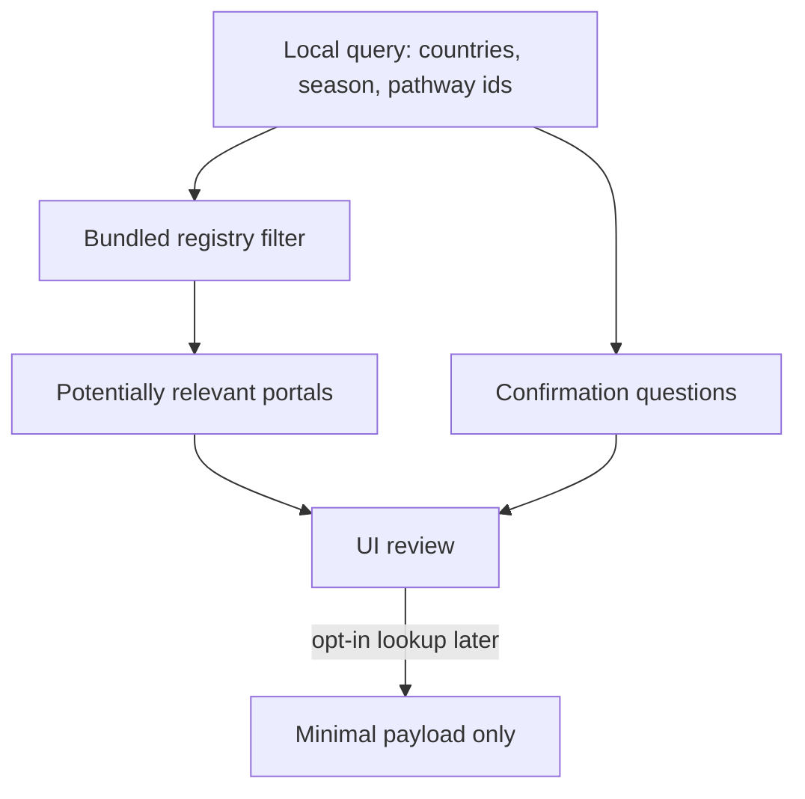

# Global pathway resolution

Resolver: `LocalHajjPathwayResolver` in `lib/domain/hajj_online_contracts.dart`.  
It runs **on the device** before any future network call.

## Inputs (no personal identifiers)

- Passport nationality country codes (all travellers; all `citizenships`)
- Legal residence country codes
- Intended departure country
- Intended return country
- Target Hajj season label
- Confirmed planning pathway ids (categories, not legal routes)
- Traveller count (for mixed-family questions only)

The resolver does **not** receive names, passport numbers, scans, health notes, or reflections.

## Outputs

- Potentially relevant registry portals
- Confirmation questions
- Unknown inputs (nationality, residence, departure, season, pathway)

It never outputs: visa eligibility, quota, registration entitlement, or religious obligation.

## Rules

1. Saudi official Hajj and Nusuk portals are always included (globally relevant).
2. National-mission portals match nationality **or** residence **or** departure.
3. Health portals (MOH, WHO) are bookmarks to confirm, not vaccination decisions.
4. Provider-register URLs are bookmarks; no operator list is generated.
5. Multiple citizenships → “Which document would you present? The app does not choose.”
6. Mixed nationalities → each person keeps a separate route question.
7. Unknown country → Saudi portals + an explicit unknown-requirements question.
8. Confirmed pathway is a planning category from Phase 3A; it is not auto-selected here.

## Sample resolution (PK nationality, AE residence, AE departure)

Relevant examples: `reg.sa.hajj.ministry`, `reg.sa.nusuk`, `reg.pk.mora`, `reg.ae.awqaf`, `reg.sa.moh`, `reg.who.travel`.  
Not included: `reg.gb.mission`.

Questions include: the app does not declare visa eligibility, registration entitlement, or religious obligation.
