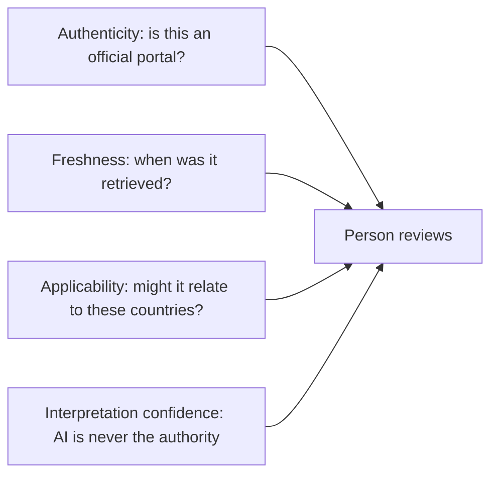

# Official-source registry

The registry is a **catalog of official portals**, not a database of current Hajj rules.

Implementation: `lib/domain/hajj_source_catalog.dart` (`BundledHajjSourceRegistry`).  
Persisted user copies remain `HajjOfficialSource` on the Hajj store (`schemaVersion` 1).

## Record

| Field | Meaning |
| --- | --- |
| Authority name | Issuing body as named by itself |
| Jurisdiction | ISO country of that body |
| Official URL | HTTPS portal to open or, later, fetch |
| Category | Saudi authority, booking platform, national mission, health, provider **register URL**, travel/visa |
| Nationality / residence / departure codes | Optional applicability hints. Empty = globally relevant. **Not eligibility** |
| Hajj season | Stored on the retrieved copy, never invented in the catalog |
| Publication / effective / retrieved / valid-until | Stored when known; catalog rows have none |
| Language | Portal languages |
| Retrieval method | `bundledCatalog` now; `futureHttpsGet` later; `manualUser` for typed sources |
| Verification | Always **Unverified** until the person marks a stored copy |

The catalog **must not** contain quotas, registration windows, prices, or named licensed operators.

## Categories

1. Saudi official Hajj authorities (`haj.gov.sa`).
2. Official booking platforms (`nusuk.sa`).
3. National missions / government Hajj pages (country-scoped URLs).
4. Health and vaccination authorities (Saudi MOH, WHO travel advice).
5. Authorised-provider **register URLs** (Nusuk services page) — no operator names.
6. Travel, visa, residence (MOFA, national travel-advice sites).

## Four distinctions (never collapsed)



| Axis | Official meaning in this app |
| --- | --- |
| Authenticity | Bookmark of an official hostname vs commercial/search/AI text |
| Freshness | Retrieved date vs 180-day stale label |
| Applicability | Resolver guess + confirmation questions |
| Interpretation | AI notes. `interpretationIsOfficial` is always false |

## Verification rules

- Search results, AI answers, and travel-agent copy are never official verification.
- Demonstration and catalog bookmarks land as **Demo — no live verification** and `unverified`.
- Manual sources stay unverified until the person taps **verified by you**.
- “Verified by you” is user judgment, not a government certificate.
- Conflicting deadlines are listed; neither is auto-chosen.
- Stale sources are labelled Outdated; they do not overwrite typed official milestone dates.

## Sample stored source (after a demo lookup)

```json
{
  "id": "src.demo.reg.sa.hajj.ministry",
  "title": "Ministry of Hajj and Umrah (Demo — no live verification)",
  "uri": "https://www.haj.gov.sa",
  "verificationStatus": "unverified",
  "demonstration": true,
  "origin": "demonstration",
  "provenance": "demonstration"
}
```
