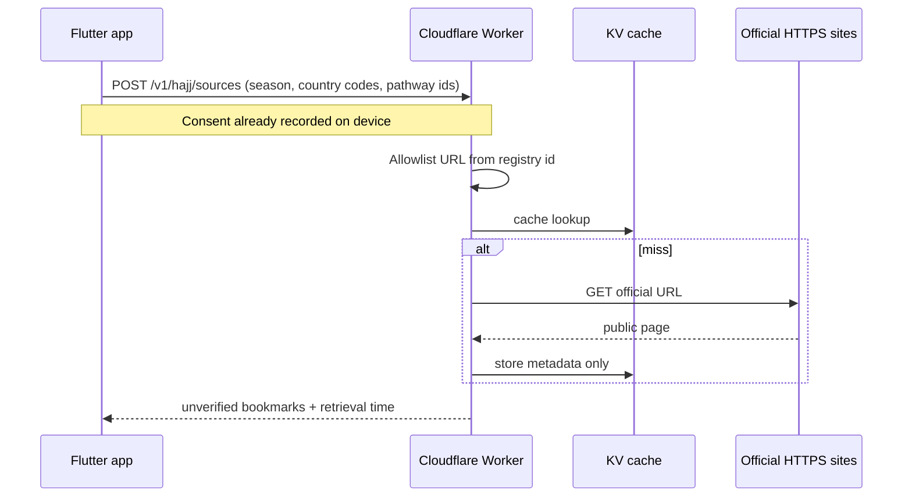

# Secure backend architecture (design only — not deployed)

Phase 3B-2A specifies a backend so Phase 3B-2B can be implemented later **without putting secrets in the APK**. Nothing here is live.

## Why a backend is required for live assistance

- Official pages and any future AI provider need credentials, rate limits, and caching.
- The phone must send only the minimum lookup payload.
- Request logs must not contain Muhasabah reflections or identity documents.

## Recommended architecture (small first user base)

**Cloudflare Worker + KV (cache) on the Workers Free plan. No R2, no AI, no Cron unless later approved.**

- TLS to the Worker; Worker holds `OFFICIAL_FETCH` allowlist. AI keys are not used.
- KV caches public HTML/metadata by adapter id (not by person), with a 24-hour TTL and stale fallback.
- First deploy target is **USD 0**: Free-plan refusals, not a dollar cap. See `docs/hajj/CLOUDFLARE_COST_CONTROL.md`.
- Add Cloudflare Turnstile or a hashed device attestation later if abuse appears.



## Alternative: Cloud Run (or Fly.io) + Postgres

- One small container, scale-to-zero, Cloud SQL or Postgres.
- Better if you later need relational provenance audits.
- Idle cost often **USD 5–20 / month**; always-on minimum instances cost more.
- More moving parts (container, DB backups, IAM).

## Comparison

| | Cloudflare Worker + KV | Cloud Run + Postgres |
| --- | --- | --- |
| Fit for <1k users | Excellent | Fine, heavier |
| Secrets | Wrangler secrets | Secret Manager |
| Cold start | Very low | Low–moderate |
| Cost at idle | ~0 | low–medium |
| Future scale | High | High |
| Ops burden | Low | Medium |

**Recommendation:** Worker + KV for 3B-2B. Revisit Postgres only if audit history outgrows KV.

## API sketch (not implemented)

`POST /v1/hajj/sources`

Request (allowed keys only):

```json
{
  "season": "1448",
  "nationalityCountries": ["PK"],
  "residenceCountries": ["AE"],
  "departureCountry": "AE",
  "returnCountry": "GB",
  "pathwayIds": ["expatriate"]
}
```

Response:

```json
{
  "demo": false,
  "sources": [
    {
      "registryId": "reg.sa.hajj.ministry",
      "url": "https://www.haj.gov.sa",
      "retrievedAt": "2026-10-18",
      "verificationStatus": "unverified"
    }
  ],
  "message": "Not official verification. Review before use."
}
```

Reject 400 if any forbidden key appears (`passport`, `reflection`, `health`, `displayName`, `notes`, `family`, `scan`).

## AI (optional, later)

- Same Worker, separate consent header `X-Hajj-AI-Consent: 1`.
- Model sees only retrieved public excerpts + the same minimum payload.
- Cost if enabled at ~100 interpretations/week: roughly **USD 10–40 / month** depending on provider and context size. **Do not enable until the owner approves.**

## Controls

- Rate limit per IP / hashed install id (not advertising id).
- Allowlist hostnames from the registry only.
- Logs: timestamp, route, country codes, status, byte size. **Never** log request bodies that might contain free text from other app screens.
- Timeouts and circuit breakers so offline Hajj Home is unaffected.
- No analytics SDK, no ads, no booking.

## 3B-2B prerequisites (approval required)

1. Cloudflare (or chosen) account and domain.
2. Secret store; no keys in Flutter.
3. Owner approval of spend caps.
4. Still no payments.
