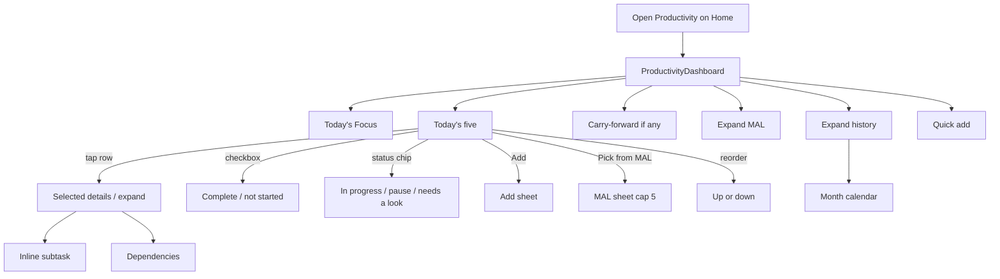

# Productivity — Dashboard design spec (P0)

**Status:** Phase P1 implemented (Home dashboard; tablet ≥ 720 lp with a dedicated side column; hours and status stay on the card body).
**Date:** 18 October 2026
**UI authority:** dashboard-first amendment (single `ProductivityDashboard`).
**Visual reference:** [`dashboard-sample.jpg`](dashboard-sample.jpg) (owner sample, 18 Oct 2026).
**Interactive HTML mockup:** [`dashboard-mockup.html`](dashboard-mockup.html) (open in a browser; Tablet / Phone toggle).

Do not commit, push, merge, deploy, or activate AI as part of P0.

---

## 0. How to read the sample

The sample is a **wide tablet/web mock** with a left app rail (Home, Qur’an, Prayer, Dhikr, Learning, Productivity, Hajj Planner, Health, Family, Finance, Notes, Settings) and top tabs **Today | Planner | Master List | Analytics**.

**Map to the real app (mandatory):**

| Sample | Flutter P1 |
| --- | --- |
| Left rail “Productivity” | Existing Home domain stage: Productivity is **one domain card/body**, not a new root navigator |
| Other rail items | Existing domains / Settings. Do **not** add a second information architecture |
| Tabs Today / Planner / Master List / Analytics | **Sections of one dashboard**, not four routes. On a phone they stack with MAL and history **collapsed**. On a tablet they become columns like the sample |
| Hajj Planner in the rail | Hajj stays **dormant** on Home; Productivity must not import Hajj |

The sample’s **Today** canvas is the interaction model to keep: focus banner, five actions, details, calendar, day’s time, carry-forward, quick add, priority guide.

---

## 1. Visual hierarchy (default)

Matches the amendment and the sample, top to bottom on a phone:

1. **Date and compact daily summary** — weekday, Gregorian, civil Hijri (sample header: Sat 18 Oct 2026 · 22 Rabi' al-Thani 1448). Compact counts: focus n/5, in progress, needs a look. Not a grade.
2. **Today’s Focus (recommended next executable)** — sample green banner: title, one-line purpose, effort bar, **Time remaining** vs planned (e.g. 2h 30m of 6h planned). Empty: “Nothing queued”.
3. **Today’s Actions (up to 5)** — numbered 1–5, reorder, checkbox/complete, status, estimate, effort bar, tags, expand.
4. **Carry-forward / blocked notices** — sample: “1 incomplete action will move to tomorrow automatically.” Omit the band when none.
5. **Selected action details** — shown when a row is selected (sample bottom-left): domain/tag, target completion, estimated time, status, subtasks, dependencies, + add subtask.
6. **Master Action List** — collapsed on phone; sample “Pick from Master List” opens a sheet. On tablet, a persistent MAL column may wait until P4; P1 uses the sheet + expandable panel.
7. **History and trends** — collapsed. Sample “Analytics” and “Today’s Time” (planned / completed / remaining hours) live here on phone; on tablet, **Today’s Time** may stay visible in the right column as in the sample.

Optional in P2: a short quote card (sample top-right). P1 should **not** build a new quotation engine. If a line is shown, reuse Reflection of the Week or omit.

---

## 2. Mobile wireframe (~360 dp)

```
┌─────────────────────────────────┐
│ Productivity            [Add]   │
│ Sat 18 Oct 2026 · 22 Rabi II    │
│ Focus 5 · In progress 1 · Look 1│
├─────────────────────────────────┤
│ TODAY’S FOCUS                   │
│ Complete Worker local…     60%  │
│ Remaining 2h 30m of 6h planned  │
│ [Start] [Pause] [Complete]      │
├─────────────────────────────────┤
│ TODAY’S ACTIONS (5)             │
│ + Add action  |  Pick from MAL  │
│ ① Fix Worker/health…  1h  Look  │
│ ② ✓ Run JS Worker tests  Done   │
│ ③ Run Flutter tests  60%  Prog  │
│ ④ Update provenance…  0%        │
│ ⑤ Prepare Phase 3B-2G report    │
├─────────────────────────────────┤
│ NOTICE (only if needed)         │
│ 1 incomplete action moves to    │
│ tomorrow automatically.         │
├─────────────────────────────────┤
│ SELECTED DETAILS (if a row tap) │
│ Subtasks · Dependencies · Date  │
├─────────────────────────────────┤
│ ▸ Master Action List            │
│ ▸ History and trends            │
│     Today’s time 6h / 0.5h / 5.5│
│     Calendar (month)            │
└─────────────────────────────────┘
[Quick add field pinned above keyboard / bottom]
```

Single column. No horizontal page swipe for the five rows. Reorder = up/down, not drag-only.

## 3. Tablet / desktop wireframe (≥ 600 lp) — follows the sample

```
┌────────────┬──────────────────────────────┬──────────────────┐
│ (app Home  │ Productivity                 │ Date + Hijri     │
│  stage,    │ Today’s Focus     Time left  │ Quote (P2)       │
│  not a new │                              │ Month calendar   │
│  rail)     │ Today’s Actions (5)          │ Today’s Time     │
│            │  1..5 cards                  │ Carry-forward    │
│            │ Selected Action Details      │ Quick Add        │
│            │                              │ Priority Guide   │
└────────────┴──────────────────────────────┴──────────────────┘
```

Same widgets as mobile. Centre = today’s five; right = calendar, day’s time, notices, quick add, priority guide; MAL/history as expandable or right-column sections.

---

## 4. Component hierarchy

```
ProductivityDashboard
├── ProductivityDayHeader
├── TodaysFocusBanner          // recommended next
├── TodaysActionList           // cap 5
│   ├── ActionRowCard × n
│   │   ├── PriorityBadge      // 1–4 colour + word
│   │   ├── CompleteCheckbox
│   │   ├── Title + one-line note
│   │   ├── TagChips
│   │   ├── EffortBar          // remaining / planned
│   │   ├── StatusChip
│   │   ├── OverflowMenu
│   │   └── ExpandInline
│   │       ├── ChildActionRow
│   │       └── GrandchildActionRow
│   ├── AddActionControl
│   └── PickFromMalControl
├── CarryForwardNotice?        // omitted if empty
├── SelectedActionDetails      // sample bottom panel; sheet on narrow
│   ├── Meta (tag, target, estimate, status)
│   ├── SubtaskList
│   └── DependencyList
├── MasterActionListPanel      // collapsed ExpansionTile / sheet
├── HistoryTrendsPanel         // collapsed
│   ├── TodaysTimeRollup
│   ├── MonthCalendar
│   └── EventLists
├── QuickAddBar
└── PriorityGuide              // collapsed on phone; side card on tablet
```

Sheets (modal bottom): add/edit title, pick from MAL, edit target date, edit dependencies, remaining-effort when the stepper is too tight.

---

## 5. Interaction flow



No `Navigator.push` for complete, priority, start, or add-to-today.

---

## 6. Action cards (sample → P1)

**Collapsed row (as in the sample):**

- Numbered priority disc **1–4** with colour **and** the guide words available in Priority Guide.
- Checkbox (complete).
- Title + one-line description.
- Tags (e.g. Main Activity · Setup).
- Clock + estimate (`1h`, `0.5h`).
- Effort bar + percent of **that action’s** estimate (visibility, not a spiritual score).
- Status chip: Not started / In progress / Completed / Needs a look.
- Overflow (priority, remove from today, delete to register).
- Chevron expands children.

**Expanded / selected details (sample bottom):**

- Domain/tag, target completion (date/time if set), estimated time, status.
- Subtasks with their own checkboxes and small estimates.
- Dependencies: “Must complete before” and “Blocks”.
- + Add subtask.

**Copy alignment with guardrails:**

| Sample | Use in app |
| --- | --- |
| Needs Attention | **Needs a look** — blocked, past the date you set, or stuck at 0% with remaining work. Not “failed” |
| Incomplete items move to tomorrow | Keep; this is carry-forward, not a penalty |
| Today’s Time 8% | Label as **effort recorded vs planned today**, not a productivity score |
| Critical / High / Medium / Low | Keep four levels **with words**; colour never stands alone |

---

## 7. Requirement → dashboard control

| Requirement | Control | P1? |
| --- | --- | --- |
| Date + summary | `ProductivityDayHeader` | Yes |
| Next executable | `TodaysFocusBanner` | Yes |
| Today’s five | `TodaysActionList` | Yes |
| Add action | Header / list **+ Add Action** + `QuickAddBar` | Yes |
| Pick from MAL | **Pick from Master List** sheet | Yes |
| Reorder | Up/down (sample says drag; a11y buttons required) | Yes |
| Change priority | Overflow or long-press disc; Priority Guide | Yes |
| Start / pause / resume / complete | Checkbox + status chip / banner buttons | Yes |
| Remaining effort | Stepper on card or sheet | Yes |
| Expand children / grandchildren | Chevron inline | Children yes; grandchildren P2 if tight |
| Prerequisites | Selected details Dependencies | Yes (view + add in sheet) |
| Target date | Selected details; date sheet | Yes |
| Carry-forward | Notice + auto rule | Yes |
| Historical details | History panel events | Yes (list) |
| Compact trends | Today’s Time + calendar | Today’s Time yes; richer trends P4 |
| Calendar | Month grid, tap day to inspect snapshot | P1 compact; full planner feel P2 |
| Quote | Sample only | P2 / omit |

---

## 8. Bottom sheet vs separate screen

**Stay on dashboard or sheet:**

- Add / quick add
- Pick from MAL
- Priority
- Status / start / pause / complete
- Remaining effort
- Target date
- Add subtask
- Add/remove dependency
- Reorder

**Separate full screen (exception only):**

- Permanent delete with multi-select from MAL (reuse listed-action register pattern) — optional P2
- Export/download of the store — Settings, not dashboard

**Do not build** as P1 routes: Planner page, Analytics page, Master List page. Those sample tabs are **sections**.

---

## 9. Implementation acceptance (P1 gate)

From the amendment, restated:

- Productivity opens **directly** into this dashboard (Home domain body).
- Create and update from the dashboard.
- Today’s five visible and manageable (add, pick, reorder, complete).
- Priority and status without a new screen.
- Hierarchy expandable inline (at least one child level).
- MAL selection from the dashboard.
- Events stored and inspectable in History.
- Usable on a small Android phone (360 dp, 1.5 text, no overflow).
- Widget tests: W1–W13 in `TEST_PLAN.md`.

## 10. Accessibility and responsiveness criteria

- 44 dp minimum on checkbox, add, complete, reorder.
- Priority and status always include **text**.
- 1.0 / 1.3 / 1.5 text scale, 360×800, no overflow.
- Light and dark; wash contrast for body text.
- TalkBack: “{title}, {status}, priority {word}”.
- Safe area + keyboard inset on sheets.
- Calendar: do not require horizontal scroll of the five action cards.
- Reorder without relying on drag.

## 11. Widget / integration test matrix

See `TEST_PLAN.md`. Dashboard-focused keys (proposed):

- `productivity-dashboard`
- `productivity-focus-banner`
- `productivity-today-list`
- `productivity-add-action`
- `productivity-pick-mal`
- `productivity-row-{id}`
- `productivity-history-panel`
- `productivity-quick-add`

## 12. What P0 is not

- No `MonitorDomain.productivity` in Dart yet.
- No Hive box yet.
- No change to Hajj, Fasting, Home title leftovers, or domain-action strip.

**Owner review asked:** confirm (1) four-level priority as in the sample, (2) Flutter Home-stage embedding rather than the mock’s left rail, (3) sample tabs as sections not routes, (4) “Needs a look” wording instead of “Needs Attention”.
